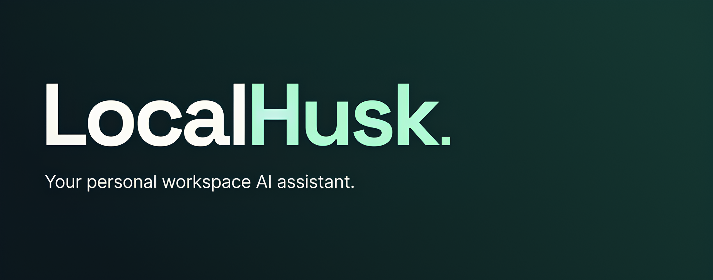

<p align="center">
  
</p>

<p align="center">
  <em>Your data. Your models. Your device.</em>
</p>

<p align="center">
  <a href="LICENSE"></a>
  <a href="#install"></a>
  <a href="#install"></a>
  <a href="#install"></a>
</p>

**LocalHusk** is an **open-source, local-first** AI assistant that runs on your computer. Chat in the terminal or the web UI, run agents with tool approval, manage tasks/notes/calendar/mail, schedule automations, and connect MCP servers — without sending your data to a third-party cloud unless **you** choose a remote model provider.

Yours, with no catch. Conversations, credentials, and memory live under `~/.husk` on your hardware. Models are plugins: Ollama, LM Studio, OpenAI, Anthropic, Gemini, or any OpenAI-compatible endpoint.

**Website** · **[Docs](USER_MANUAL.md)** · **[Getting started](#install)** · **[Contributing](CONTRIBUTING.md)**

---

## Install

The installer supports **Linux** and **Windows**. It sets up Python, the backend, the UI sources, and a `husk` command on your PATH.

### Linux / WSL2

```bash
curl -fsSL https://raw.githubusercontent.com/nikhilken14/husk/main/install.sh | bash
```

### Windows (PowerShell)

```powershell
irm https://raw.githubusercontent.com/nikhilken14/husk/main/install.ps1 | iex
```

### Already have the repo?

```bash
git clone https://github.com/nikhilken14/husk.git
cd husk
./install.sh          # Linux
# .\install.ps1       # Windows
```

### Prefer a zip download?

1. Open **[Releases](https://github.com/nikhilken14/husk/releases)**
2. Download **`husk-*-full.zip`** (or the source archive)
3. Extract and run `./install.sh` or `.\install.ps1`

Then open a **new terminal** and run:

```bash
husk
```

> **First release:** This is **v1.0.0**. Create a GitHub Release with tag `v1.0.0` (and attach the full zip from the Release workflow) so the Releases page is populated.

---

## Quick start

```text
husk                 Start the interactive CLI
/llm                 Configure your model
/ui                  Open the web UI
/help                List commands
/exit                Quit
```

| Requirement  | Notes                                        |
| ------------ | -------------------------------------------- |
| Python 3.11+ | Backend                                      |
| Node.js 18+  | Web UI only (optional for pure terminal use) |
| curl         | Health checks / terminal chat fallback       |

---

## What LocalHusk includes

| Layer       | Stack                                              |
| ----------- | -------------------------------------------------- |
| **CLI**     | Native Rust launcher + Python fallback (`husk.py`) |
| **Backend** | FastAPI, SQLite, Alembic (`husk/`)                 |
| **Web UI**  | React, TypeScript, Vite (`ui/`)                    |

Prebuilt CLI binaries for **Linux** and **Windows** are in `builds/`. The installer prefers these when present.

- Pluggable LLMs (local or remote)
- Agents with catalog tools and approval gates
- Tasks, notes, calendar, mail (OAuth)
- Automations and MCP server connections
- Shared model store across CLI, API, and UI

---

## Uninstall

```bash
# Linux
rm -rf ~/.husk
# remove LocalHusk / Husk lines from ~/.bashrc or ~/.zshrc if present
```

```powershell
# Windows
Remove-Item -Recurse -Force $env:USERPROFILE\.husk
```

---

## Development

See [CONTRIBUTING.md](CONTRIBUTING.md).

```bash
cd husk && python -m venv .venv && source .venv/bin/activate
pip install -e .
pytest

cd ../ui && npm install && npm run dev
cd ../cli-rs && cargo build --release
```

---


---

## Documentation

| Doc | Description |
|-----|-------------|
| [USER_MANUAL.md](USER_MANUAL.md) | End-user guide |
| [ARCHITECTURE.md](ARCHITECTURE.md) | System design |
| [DEVELOPMENT.md](DEVELOPMENT.md) | Contributor setup |
| [SECURITY.md](SECURITY.md) | Security policy & controls |
| [CHANGELOG.md](CHANGELOG.md) | Release history |
| [CONTRIBUTING.md](CONTRIBUTING.md) | How to contribute |
| [CODE_OF_CONDUCT.md](CODE_OF_CONDUCT.md) | Community standards |

## License

[MIT](LICENSE) — free to use, modify, and distribute.

**Version:** v1.0.0
